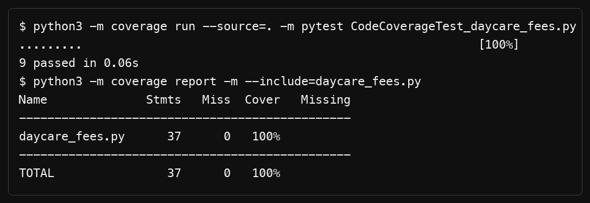
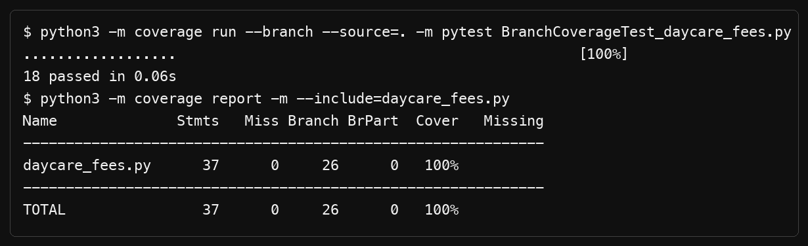

# L6_L7_48 — Daycare Fees

Lab 6: Code and Branch Coverage

## About

A small Python module that works out extra-hours fees by age group, hours and sibling discount, checks whether an enrolment is allowed and reports child pickup status.

## Files

| File | Description |
|------|-------------|
| `daycare_fees.py` | The module under test |
| `test_daycare_fees.py` | Starter test file |

All Lab 6 deliverables are available in the repository root for easy access.

## Coverage results

Run these commands from the repository root:

```bash
python3 -m coverage run --source=. -m pytest CodeCoverageTest_daycare_fees.py
python3 -m coverage report -m --include=daycare_fees.py
```

The line-coverage test suite reports 100% coverage for `daycare_fees.py`.

```bash
python3 -m coverage erase
python3 -m coverage run --branch --source=. -m pytest BranchCoverageTest_daycare_fees.py
python3 -m coverage report -m --include=daycare_fees.py
```

The branch-coverage test suite reports 100% statement coverage and 100% branch
coverage for `daycare_fees.py`.

## Coverage analysis

### Code coverage analysis

The code-coverage suite executes every executable statement in
`daycare_fees.py`. The report contains 37 statements, with 0 statements
missing, giving **100% line coverage**. The tests cover invalid inputs,
included-hour limits, sibling allowances, age-group fee rates, enrolment
eligibility, and each pickup status.



### Branch coverage analysis

The branch-coverage suite checks both outcomes of each decision, not just
whether a line was executed. It covers the validation branches, sibling and
age-group conditions, fee thresholds, enrolment conditions, aftercare and
Friday cutoffs, and on-time, late, and overdue pickup outcomes. The report
contains 26 branches, with 0 partial branches, giving **100% branch coverage**
and **100% statement coverage**.



Together, the two suites show that all executable lines and all measured
decision paths in the daycare-fees module are exercised by tests.
